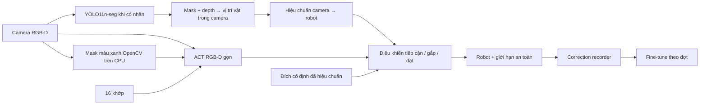

# Kế hoạch train cho một vật và một đích cố định

## Kiến trúc



Đường train đã được chuẩn bị là ACT RGB-D với mask vật màu xanh làm kênh thứ 5. Mask được tính trên CPU, không cần thêm VRAM cho detector. YOLO là nhánh perception riêng sau khi có ảnh gán nhãn. Đầu ra `act_pipeline/perception.py` là tọa độ trong hệ camera; cần ma trận ngoại tham số camera–robot trước khi dùng làm lệnh gắp. Repo này không có driver robot hoặc IK, nên bước điều khiển cuối cần tích hợp vào phần mềm robot.

### Kết quả đọc episode mẫu

`data_sample/episode_20261008_152534.hdf5` có 809 frame RGB-D 640×480, khoảng 50 Hz. Ảnh cho thấy vật màu xanh ở mép bàn được đưa lên vùng trắng cố định. `/action` trùng `qpos` ở mọi bước nên không phù hợp làm nhãn lệnh; `/joint_commands` có NaN ở 55 frame đầu, rồi đầy đủ. File đã được chuyển thành `data_set/pick_place/episode_20261008_152534.hdf5` với 754 frame và action lấy từ `joint_commands`. Preset gọn resize ảnh 4:3 về 320×240 nên không cần vùng đệm.

Với các episode mới từ cùng recorder, chạy:

```bash
python3 prepare_pick_place.py --input /path/to/new_episode.hdf5 \
  --output_dir data_set/pick_place
python3 preview_object_mask.py \
  --episode data_set/pick_place/new_episode.hdf5 \
  --output outputs/new_episode_mask.jpg
```

Xem ảnh preview trước khi train; ngưỡng HSV hiện được hiệu chỉnh theo hộp xanh trong episode mẫu. Khi tay robot che hộp hoàn toàn, mask có thể rỗng và ACT vẫn nhận RGB-D gốc. Phép trừ nền depth đã được thử trên mẫu nhưng nhầm tay robot với hộp và bỏ sót hộp ở đầu episode. Để bớt phụ thuộc màu, dùng mask hiện tại tạo nhãn box gợi ý rồi train YOLO sau khi có thêm episode và review nhãn.

## 1. Chuẩn bị dữ liệu trước buổi train

Mỗi episode cần `/observations/images/chest_rgb`, `/observations/images/chest_depth`, `/observations/qpos`, `/action`, và `timestamp_ns` theo [DATA_FORMAT_SPECIFICATION.md](DATA_FORMAT_SPECIFICATION.md). Mỗi file phải là một lần thực hiện độc lập. Ghi rõ `action` là lệnh khớp thật sự gửi xuống robot, cùng đơn vị với qpos. Kiểm tra depth đã align với RGB và độ phân giải khớp nhau.

Trước khi train trên máy GPU, cài `torch` và `torchvision` phù hợp với CUDA của máy, rồi chạy `python3 -m pip install -e .`. Cần `h5py>=3.16` để đọc file mẫu tạo bằng HDF5 2.0. Backbone ResNet-18 mặc định cần weights ImageNet trong cache hoặc kết nối để tải lần đầu. Repo có một episode mẫu; dữ liệu và weights không được commit vào Git.

Kiểm tra riêng **đơn vị gripper** trong dữ liệu thu thực tế: các README hiện mô tả gripper theo rad, còn validator dùng mét. Toàn bộ record, train và lệnh gửi robot phải dùng cùng một quy ước.

```bash
python3 validate_dataset.py data_set/pick_place
```

Để đánh giá khả năng tổng quát, thu nhiều vị trí/hướng ban đầu của **cùng một vật**, cả các lần thao tác khó. Dữ liệu huấn luyện và validation được tách theo episode; `episode_split.json` sẽ giữ nguyên split cho mỗi run. Nếu dữ liệu thay đổi, tạo `output_dir` mới. Hiện mới có **một episode**, cần ít nhất hai để train/validation tách biệt; thực tế nên thu nhiều episode ở các điều kiện khác nhau.

## 2. Train ACT gọn ngay từ HDF5

```bash
python3 train.py \
  --preset pick_place_low_vram \
  --object_mask \
  --dataset_dir data_set/pick_place \
  --output_dir checkpoints/pick_place_v1 \
  --epochs 300 --device cuda --save_logs
```

Preset dùng ảnh 240×320 RGB-D + mask hộp xanh, Transformer `d_model=256`, decoder 2 lớp, CVAE 1 lớp, chunk 10 bước (0,2 s ở 50 Hz), batch 8 và AMP. Đây là điểm khởi đầu; điều chỉnh `--batch_size` theo VRAM thực tế. Checkpoint PyTorch được lưu để resume/fine-tune. ONNX được tắt trong lúc train để giảm thời gian xuất lặp lại; xuất sau khi chọn checkpoint:

```bash
python3 export_onnx.py --checkpoint checkpoints/pick_place_v1/best_checkpoint.pth \
  --output checkpoints/pick_place_v1/act_deploy.onnx
```

Validation chọn checkpoint theo dự đoán với latent `z=0`, giống inference. `val_epoch/loss` vì vậy là sai số action của đường deploy. Chỉ số offline này không thay thế tỷ lệ gắp và đặt thành công trên robot.

Đánh giá riêng các episode validation:

```bash
python3 eval.py --checkpoint_path checkpoints/pick_place_v1/best_checkpoint.pth \
  --dataset_dir data_set/pick_place \
  --split_json checkpoints/pick_place_v1/episode_split.json \
  --output_dir evaluation_results/pick_place_v1 --device cuda
```

Tiếp tục cùng một run:

```bash
python3 train.py --preset pick_place_low_vram \
  --object_mask \
  --dataset_dir data_set/pick_place \
  --output_dir checkpoints/pick_place_v1 \
  --epochs 400 --resume auto --device cuda --save_logs
```

Giữ nguyên tham số kiến trúc khi resume. Nếu muốn đổi chunk/model size, dùng run mới và train lại từ đầu.
Để fine-tune checkpoint RGB-D 4 kênh cũ với mask mới, dùng `--init_checkpoint` cùng kích thước model cũ và `--object_mask`; loader sẽ mở rộng riêng conv đầu từ 4 lên 5 kênh. Checkpoint `d_model=512` không nạp vào preset `d_model=256`.

GPU 30 GB cho phép chạy thêm baseline ACT đầy đủ để so sánh chất lượng với bản gọn, dùng cùng dataset và seed nhưng `output_dir` riêng:

```bash
python3 train.py --dataset_dir data_set/pick_place \
  --object_mask \
  --output_dir checkpoints/pick_place_full --epochs 300 \
  --batch_size 16 --img_height 240 --img_width 320 \
  --save_pth --no_onnx --device cuda --save_logs
```

Chọn bản deploy theo **tỷ lệ hoàn thành task, VRAM đỉnh và độ trễ thực đo**; dung lượng VRAM train 30 GB không phải là giới hạn VRAM lúc inference.

## 3. Train YOLO khi có nhãn

Xuất frame rõ vật và box gợi ý từ mask màu. Hiện một episode đã được xuất vào `data_set/detector_box` (41 ảnh); chỉ dùng để review nhãn, chưa đủ validation độc lập. Khi có thêm episode, xuất lại theo `episode_split.json` của run ACT để giữ đúng train/val theo episode:

```bash
python3 export_detector_frames.py --dataset_dir data_set/pick_place \
  --output_dir data_set/detector_box_v2 \
  --split_json checkpoints/pick_place_v1/episode_split.json \
  --stride 10 --pseudo_boxes
```

Review và sửa box của **một class hộp xanh** trên ảnh xuất ra, đặc biệt frame bị tay che và vùng ánh sáng thay đổi. Nhãn tự sinh hiện là **box detection**, chưa phải segmentation. Công cụ tạo `data.yaml`, `frame_manifest.json` và hai thư mục labels. File YAML có dạng:

```yaml
path: /absolute/path/to/detector_dataset
train: images/train
val: images/val
names:
  0: object
```

```bash
python3 -m pip install -e '.[detector]'
python3 train_detector.py --data data_set/detector_box_v2/data.yaml \
  --task detect --epochs 100 --imgsz 416 --batch 8 --device 0
```

Ở chế độ detect, mặc định train từ `yolo11n.pt`. Nếu gán nhãn mask thủ công, đổi sang `--task segment` để dùng `yolo11n-seg.pt`. Sau train, đo recall, sai số tâm/pose 3D, độ trễ và VRAM trên phần cứng deploy. `SingleObjectPerception` nhận RGB, depth đã align và intrinsics, trả vị trí camera XYZ; nó không tự biến đổi sang tọa độ robot. Dữ liệu từ nhiều episode và augment màu sẽ giúp detector học thêm hình dạng/texture, nhưng vẫn cần đánh giá trên điều kiện ánh sáng mới để biết mức độ ít phụ thuộc màu thực tế.

## 4. Giai đoạn sau: thu correction và fine-tune

Khi operator takeover, ghi **toàn bộ episode** bằng `CorrectionEpisodeRecorder`. Mỗi bước gồm ảnh RGB-D, qpos, action thực thi, action ACT đề xuất, timestamp và cờ intervention. Ví dụ ở mã tích hợp robot:

```python
from act_pipeline.data.correction import CorrectionEpisodeRecorder

with CorrectionEpisodeRecorder("data_set/corrections/episode_001.hdf5") as recorder:
    # Trong vòng điều khiển: lấy observation và lệnh thực tế từ driver robot.
    recorder.append(rgb, aligned_depth, qpos, executed_action,
                    policy_action, timestamp_ns, intervention=True)
```

Recorder ghi ở luồng riêng và báo lỗi nếu hàng đợi đầy. Chỉ đưa episode đã kết thúc, đã kiểm tra dữ liệu và có action đúng vào `correction_dir`. Fine-tune offline từ checkpoint **cùng kiến trúc**:

```bash
python3 train.py --preset pick_place_low_vram \
  --object_mask \
  --dataset_dir data_set/pick_place \
  --correction_dir data_set/corrections --correction_repeat 2 \
  --init_checkpoint checkpoints/pick_place_v1/best_checkpoint.pth \
  --output_dir checkpoints/pick_place_v2 \
  --epochs 100 --lr 2e-5 --device cuda --save_logs
```

Correction episodes chỉ đi vào train. Giữ một tập validation độc lập chưa từng dùng làm correction và so sánh với v1. Khi triển khai, so sánh tỷ lệ gắp thành công, tỷ lệ đặt đúng vùng đích, sai số vị trí, thời gian chu kỳ, độ trễ inference và VRAM đỉnh. Cập nhật trọng số theo đợt sau khi đánh giá; trong lúc chạy, correction dùng để sửa lệnh hoặc takeover.

## Trạng thái cần hoàn thiện trên robot

- Ghi nhãn ảnh vật thể và train YOLO nếu detector cần thiết.
- Hiệu chuẩn intrinsics/extrinsics camera và pose đích cố định.
- Tích hợp `SingleObjectPerception` và `CorrectionEpisodeRecorder` vào driver, IK và bộ giới hạn khớp hiện có.
- Đo rollout trên robot. Repo hiện chỉ có huấn luyện và đánh giá offline, nên chưa có số liệu thành công thực tế.
